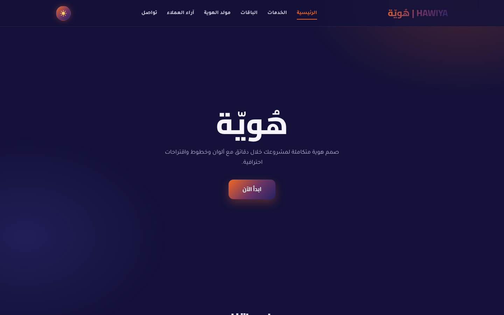
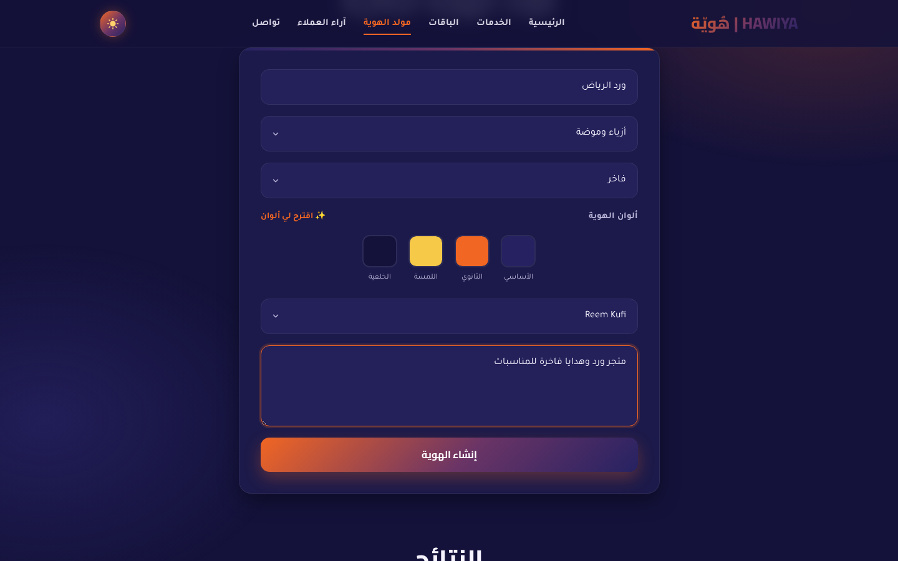
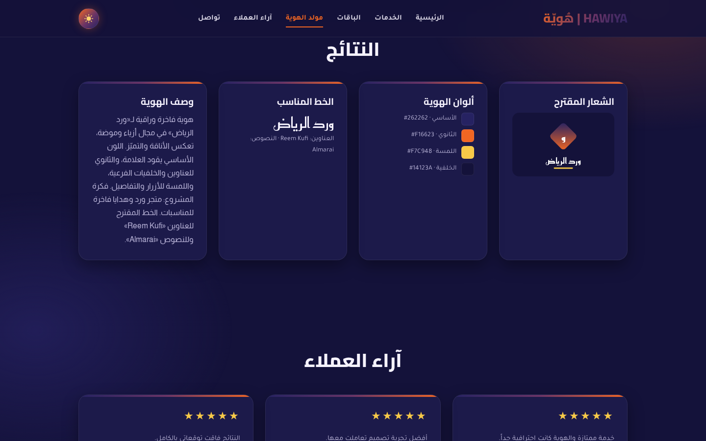

# HAWIYA | هُويّة


Arabic (RTL) website for a visual-identity design studio, with a built-in **identity generator**: enter a project name, its activity and the identity style, and the site suggests a colour palette, a logo concept, a font pairing and a short identity description.

> 🇸🇦 [النسخة العربية](README_AR.md)

## 📸 Screenshots

| Home | Identity generator | Results |
|---|---|---|
|  |  |  |

## ✨ Features

- Sections: Home, Services, Packages, Identity Generator, Reviews and Contact
- **Identity generator** — deterministic palette (4 colours), logo concept (SVG), font pairing and description, based on activity × style
- Dark navy & orange gradient theme with a light-mode toggle (remembered per visitor)
- Responsive layout with a mobile menu, active-section highlighting and scroll reveal animations
- Form validation for the generator and contact form
- No frameworks, no build step

## 🚀 Getting Started

```bash
git clone https://github.com/fay-naif/Hawiya.git
cd Hawiya
npm start        # serves the site locally
npm test         # runs the identity engine tests
```

Or just open `index.html` in a browser.

## 🧠 How the generator works

`js/core/identity-engine.js` hashes the project name, activity and style into a seed, so the same input always produces the same identity.

- **Activity** sets the base hue range (e.g. food → warm oranges, tech → blues)
- **Style** sets saturation, brightness, fonts and the logo shape (modern, luxury, minimal, playful, classic)
- The palette is built from the base hue: primary, secondary (analogous), accent (complementary) and a dark background

## ✏️ Changing the brand name

The name appears in one place only — `js/config.js`:

```js
brand: { ar: "هُويّة", en: "HAWIYA" }
```

## 📁 Project Structure

```
Hawiya/
├── index.html
├── css/
│   ├── main.css            # imports everything below
│   ├── variables.css       # colours, fonts, spacing (dark + light)
│   ├── base.css · layout.css · animations.css · responsive.css
│   ├── components/         # buttons, cards, forms, header, footer, toast
│   └── sections/           # hero, packages, generator, reviews
├── js/
│   ├── config.js           # brand name
│   ├── main.js             # entry point
│   ├── core/identity-engine.js
│   ├── modules/            # branding, navigation, theme, reveal, generator, contact-form
│   └── utils/dom.js
├── assets/icons/
├── tests/identity-engine.test.mjs
├── docs/ARCHITECTURE.md
└── screenshots/
```

## 📮 Contact form

The contact form validates input and shows a confirmation. To receive messages, connect it to a form service (e.g. Formspree or Web3Forms) or your own backend in `js/modules/contact-form.js`.

## 👩‍💻 Author

**Fay Naif** — [GitHub](https://github.com/fay-naif)

## 📄 License

[MIT](LICENSE)
